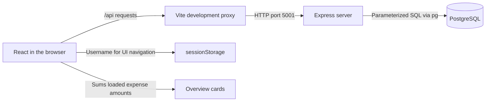
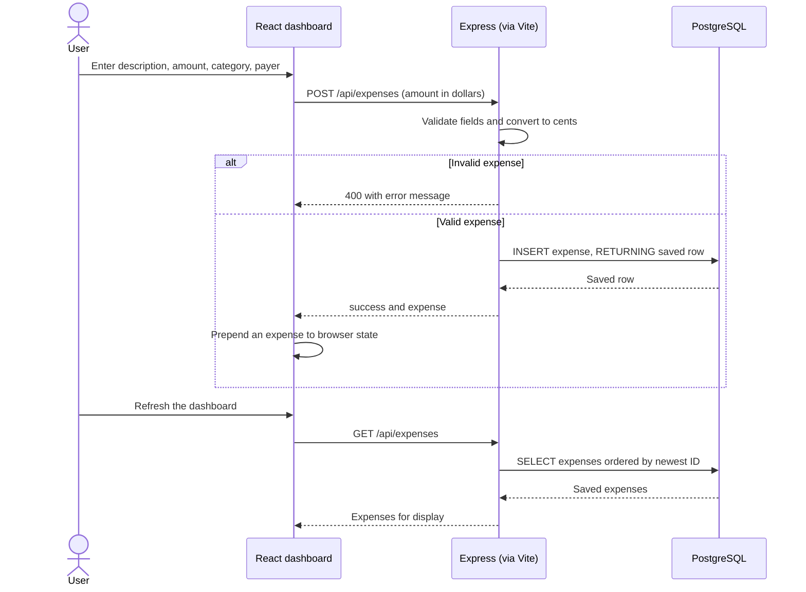

# FairShare

FairShare is a roommate expense app built with React, Express, and PostgreSQL.

## Requirements
- Node.js 24 LTS and npm.
- PostgreSQL running locally, with `psql` and `createdb` on your PATH.
- A PostgreSQL role that can connect and create tables in the app database.

## Install
```sh
git clone https://github.com/DivitP/FairShare.git
cd FairShare
npm ci
createdb fairshare
```
If your PostgreSQL role differs from your OS username, use `createdb -U ROLE fairshare`.
If the database already exists, skip `createdb`.

## Start the backend
```sh
export DATABASE_URL='postgresql://localhost:5432/fairshare'
npm run server
```
Supply your own PostgreSQL credentials in `DATABASE_URL` if required; never commit them.
The server creates its tables on startup and listens on port 5001.

## Start the frontend
In a second terminal, from the same project directory:
```sh
npm run dev
```
Open the URL printed by Vite (normally http://localhost:5173).
Vite forwards `/api` requests to port 5001; keep the backend on that port locally.
Create an account, sign in, and use **Add expense** on the dashboard.

## Build and troubleshoot
- `npm run build` produces the frontend in `dist/`; it does not start the API.
- Connection refused: check that PostgreSQL and the backend are running.
- Database authentication errors: check your role and `DATABASE_URL`.
- Port occupied: stop the conflicting process; changing API ports also requires updating `vite.config.mjs`.

## Current limitations
Saved expenses reload from PostgreSQL, but overview totals are not yet per-person balances.
Groups, settlements, and several navigation items are unfinished. Server-side access control is still required before public use.

## Architecture

### Components


`src/App.jsx` selects the login, signup, or dashboard screen.
`src/auth/` sends account requests; `src/dashboard/` renders the expense form and overview.
`vite.config.mjs` proxies local API requests to `server/index.js`.
The server stores accounts and expenses in PostgreSQL.
Browser storage selects the UI; it is not server-verified authorization.
The Vite proxy shown here describes local development, not a production deployment.

### Add-expense sequence


The database stores integer cents. The current dashboard constructs its display row locally.
Refreshing loads saved rows; per-person shares and balances are still provisional.
Database failures return an error; the success path above does not imply a completed payment.
Update both diagrams when group ownership, balance calculations, or sessions change.
